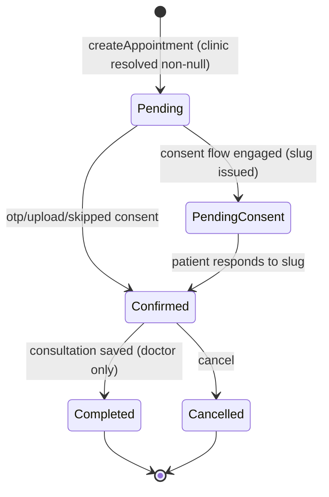

# Data Model — Role Authorization & Scoping Fixes

**Feature**: `001-role-security-fixes` | **Date**: 2026-10-19 | **Spec**: [`spec.md`](./spec.md)

No new application entities are introduced. This feature adds **invariants and a read-scope rule to
existing entities**, plus two permission catalog rows.

---

## 1. Appointments — the null-clinic invariant

**Current defect**: `resolveClinic` returns `null` on a receptionist
clinic-assignment violation (`app/doctor/appointments/actions.ts:143-149`); callers at `:309` and
`:572` pass the value into `getSchedulesForDay` with no null check, so the row is written with
`clinic_id = NULL`. Live data: **9 such rows**.

| Field | Type | Invariant after this feature |
|---|---|---|
| `clinic_id` | `bigint` nullable | MUST be non-null on create; `NULL` tolerated on read/display for legacy rows only |
| `doctor_id` | `bigint` not null | MUST be within the caller's resolved scope |
| `status` | `varchar` | `pending` → `pending_consent`/`confirmed` → `completed`/`cancelled` |

**State transitions and their guards** (book path, `createAppointment`):

Every transition above except the initial create MUST emit an audit entry; `saveConsultation`,
`updateAppointmentStatus` and `updateFollowUpStatus` currently do not (FR-022).

**Migration rule (R8)**: one numbered migration sets `clinic_id` for the 9 null rows to the
appointment's doctor's first active clinic, logs the affected count, and is idempotent
(`WHERE clinic_id IS NULL`).

---

## 2. Receptionist clinic assignment — becomes the read scope

`receptionist_clinics(receptionist_id, clinic_id, is_active)` — already present in the schema and
migrated (`0011`), already maintained by the owner UI.

| Rule | Source |
|---|---|
| Read scope = clinic_ids where `receptionist_id = caller` AND `is_active = true` | FR-003 |
| Empty result set = no clinic data at all (mirrors a manager with no `clinic_managers`) | FR-006 |
| The legacy practice-wide fallback is removed from `getReceptionistClinicIds` | R1 |
| Doctor ids for those clinics come from `doctorIdsForClinics` (active members) | existing |

The single existing caller (`app/doctor/appointments/actions.ts:146`) keeps the
`{ fallbackToPractice: true }` option **removed**; its failure mode changes from silent null to a
returned error (FR-004).

---

## 3. Permission catalog — two new rows

| Permission | Parent of | Referenced by |
|---|---|---|
| `consultations` | `consultations-view/create/edit/delete` | `lib/auth/permissions.ts:130` `/admin/consultations` |
| `online-consultations` | `online-consultations-view/create/edit/delete` | `lib/auth/permissions.ts:132` `/admin/online-consultations` |

Validation rule (FR-011): every `perm` value in `ADMIN_ROUTE_PERMISSIONS`, `DOCTOR_ROUTE_PERMISSIONS`
and `DELEGABLE_MANAGER_MODULES` MUST resolve to a catalog row — enforced by a new check script
(analogous to `check-db-schema.mjs`) so this cannot drift again.

Live baseline: 68 permissions; the two names above are absent; `home-visit`, `chat`, `shop`,
`support`, `income-expense` all exist.

## 4. Manager module grants

`model_has_permissions(model_id, model_type, permission_id)`. `DELEGABLE_MANAGER_MODULES`
(`app/admin/managers/actions.ts:21-30`) widens from 8 to 14 modules; the three owner-only modules
(`managers`, `clinics`, `business-settings`) stay non-delegable, gated on `viewerRole` exactly as
today. `createManager` (`:149-186`) gains the default grant set from R1/D2 so a new manager is
usable on first login.

## 5. Duty state — one written column

| Column | After this feature |
|---|---|
| `users.on_duty` | **Written** by the duty control; read by the header pill and the SOS broadcast |
| `users.clinic_on_duty` | Read-only legacy; no writer; display falls back to `on_duty` |
| `users.home_visit_on_duty` | Same |

The header pill (`components/dashboard/header.tsx:190`) and `dutyModeOf` (`app/doctor/layout.tsx:129`)
must agree on one input; the tooltip may only promise a control that exists for the viewer's role.

## 6. Business scope derivation (unchanged, now also used by the API)

No schema change. The derivation the fix reuses:

| Viewer | Tenant source |
|---|---|
| `admin` (owner) | `businesses.owner_id = user.id AND businesses.is_active` → `business_clinics` → clinics |
| `manager` | `clinic_managers.user_id = user.id AND is_active` → clinics (+ `business_id`) |
| `doctor` | `doctor_clinics.doctor_id = user.id` (+ active `clinic_doctors`) |
| `receptionist` | `receptionist_clinics` (new, R1) |

Note `users` carries **no `business_id`**; tenancy is always derived. `resolveManagerScope`
(`lib/auth/scope.ts:76`) additionally gains the `doctor_clinics.is_active` filter (FR-021).

## 7. Consent retention

`appointment_consult_consents` gains no columns. `getConsentBySlug`
(`lib/queries/consent.ts:21-38`) selects `created_at` and applies
`Date.now() - created_at > CONSENT_TTL_MS` — the same predicate as
`app/(marketing)/my-consent/[slug]/actions.ts:115` and
`app/api/consents/[slug]/file/route.ts:69`.

## 8. Personal access tokens

`personal_access_tokens.abilities` exists but is never read. This feature does **not** build ability
parsing; the endpoint derives scope from the token holder's role instead (R7). No schema change.
